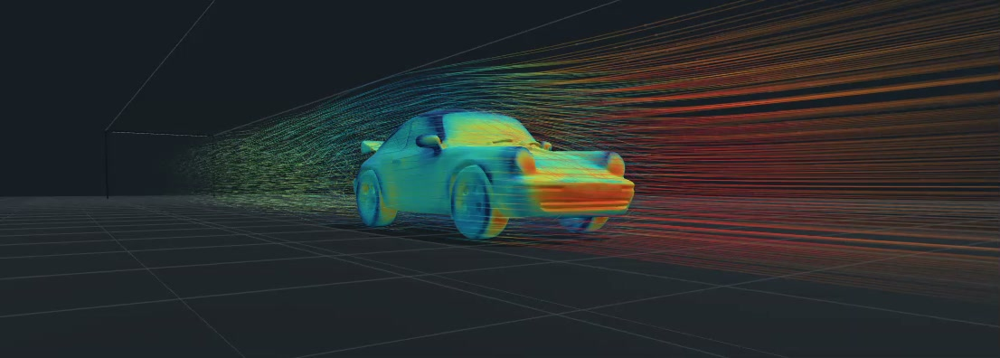

# AXABRA CFD

> **For mathematicians, engineers and scientists, AI is not the end. It is the beginning.**
>
> I was trained as an aerospace engineer.
>
> Today, AI makes it possible to build your own scientific tools instead of waiting for the perfect software to exist.
>
> Example: this small computational wind tunnel.
>
> Built from scratch in one day.
>
> This is a work in progress, and this video is a demo of the current prototype.
>
> The hardest part is getting well-designed 3D models without errors.
>
> AI does not replace mathematics, physics or engineering.
>
> It gives them leverage.
>
> And that is where things become interesting.
>
> #AI #Mathematics #Engineering #Aerospace #CFD #ScientificComputing

**Work in progress by Axel Abdel Rahamane Meghezzi.**

AXABRA CFD is an experimental local computational wind tunnel and scientific visualization project. This first public snapshot is a clean showcase while the application source, asset provenance and release packaging are being prepared for publication.

**[Watch the 63-second MP4 demonstration](demo/axabraCFD.mp4)**

The visual vehicle model shown in the demonstration is credited in [MODEL_ATTRIBUTION.md](MODEL_ATTRIBUTION.md). The model file itself is not distributed in this repository.

## What the demonstration shows

The video shows the current interactive viewport rendering a vehicle, scalar colours and airflow traces inside a virtual wind tunnel. It demonstrates the interface and the direction of the project.

The hardest practical problem is often the 3D geometry itself: obtaining a model that is correctly drawn, watertight, consistently oriented and free of mesh or topology errors. A visually convincing model can still be unsuitable for a CFD calculation. Geometry preparation and explicit rejection of invalid inputs are therefore central parts of the project.

## Development system

The current local build is organized around:

- a browser based Three.js interface for geometry and field visualization;
- a local Node.js service for project data, validated imports and job control;
- geometry preparation and watertightness checks before a CFD job is admitted;
- OpenFOAM under Ubuntu/WSL for new local calculations;
- local result processing for velocity, pressure, vorticity and related fields;
- experimental Weyl aware diagnostics kept distinct from solver validation.

The intended workflow is described in [ARCHITECTURE.md](ARCHITECTURE.md). Current release boundaries and the publication roadmap are in [PROJECT_STATUS.md](PROJECT_STATUS.md).

## Public repository scope

This snapshot contains the demonstration and technical overview. It deliberately excludes user models, CFD jobs, generated results, bundled runtimes, build outputs and application source that has not completed the public release audit.

The demonstration is **not** a physical validation, engineering certification or performance claim. No drag coefficient, convergence result or vehicle comparison should be inferred from it.

## License status

No project wide license has been declared for this showcase. Licensing and third party provenance review are part of the source release work. Third party components will retain their own licenses when publishable source is added.
